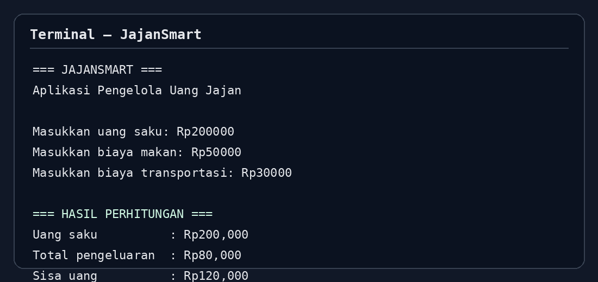

# JajanSmart

Project Ujian Tengah Semester (UTS) mata pelajaran Pemrograman Dasar / Koding & Kecerdasan Artifisial kelas X PPLG. Aplikasi ini dibuat dalam dua versi bahasa pemrograman, yaitu **C** dan **Python**.

## Identitas Siswa
* **Nama Lengkap:** Bryan Alaric
* **Kelas:** X PPLG
* **No. Absen:** [Isi nomor absen]

## Deskripsi Aplikasi
JajanSmart adalah aplikasi sederhana untuk membantu mengelola uang jajan. Pengguna memasukkan jumlah uang saku, biaya makan, dan biaya transportasi. Program menghitung total pengeluaran, sisa uang, serta rata-rata biaya dari dua jenis pengeluaran. Program juga memberikan keterangan apakah uang saku masih cukup.

## Daftar File
* `jajansmart.c` : Kode program menggunakan bahasa C.
* `jajansmart.py` : Kode program menggunakan bahasa Python.
* `output-program.png` : Screenshot contoh hasil menjalankan program aplikasi.

## Screenshot Output Program

